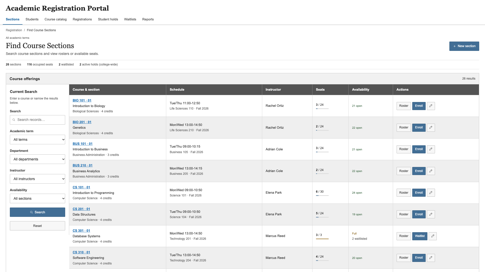

# YW-RegSytems · Campus Register

**Wail Mohammed and Yesenia Ruiz** · Database-class project · Instructor Tian Zhou

A local college course-registration web application based on our database-class SRS, ER design, and relational schema. The frontend uses **Angular 22 and TypeScript 6**; the backend uses **Node.js and Express**, with **local MySQL** for persistence and SQL processing.

[Report](report.pdf) · [Updated ER diagram](docs/er-diagram.svg) · [Relationship constraints](docs/RELATIONSHIPS.md) · [SQL examples](docs/feature-queries.sql)



## Run locally

Prerequisites: MySQL 8.0.16 or newer, a modern browser, and **Node.js 24.15+ in the 24.x series**. The `.nvmrc` selects Node 24. Angular also supports the compatible Node versions listed in `package.json`; the old Node 18 runtime cannot build this frontend.

```sh
git clone https://github.com/Wail-Mohammed/YW-RegSytems.git
cd YW-RegSytems
npm ci
cp .env.example .env
```

Edit `.env` with your own MySQL host, port, user, password, and database name. Then:

```sh
npm run db:setup
npm start
```

Open **http://localhost:3000/**. `npm start` builds Angular and starts Express, which serves the compiled frontend and `/api` from the same local origin. Change `PORT` in `.env` if 3000 is in use. Configuration defaults to loopback access.

`db:setup` creates the configured database, ten tables, and sample records in an empty database. It preserves a complete existing database and does not reseed it. The setup account needs appropriate CREATE permissions. `sql/schema.sql` and `sql/seed.sql` also work from MySQL Workbench with your chosen database selected.

### Separate demonstration MySQL instance

On a computer with MySQL installed, these helpers can initialize a separate, user-owned instance on port 3307, without changing the system MySQL data or password:

```sh
npm run local:setup
npm run local:start
```

Set `MYSQLD` to the mysqld executable if it is not in a standard location. Set `LOCAL_DB_PORT` before the first setup if 3307 is occupied. The helper preserves an existing `.env` instead of silently replacing your configuration. Stop the app with Ctrl+C; `npm run local:stop` stops only the helper instance.

On Wail's existing computer, `./scripts/npmw start` selects the separately installed compatible Node runtime. Teammates with Node 24 installed can use ordinary `npm` commands.

For an older project database that lacks `students.major`, back it up and apply `sql/migrations/001_student_major.sql` once. Fresh databases already include that field.

## Features

- **Sections:** SQL-backed keyword, term, department, instructor, and availability filters; section add/edit forms and joined rosters.
- **Students:** search names, email, ID, or major; add/edit records and view joined registration history.
- **Course catalog:** add/edit courses and manage direct prerequisite links with cycle rejection.
- **Registrations:** enroll students, update status, and enter or correct final grades. Grade controls follow the selected status.
- **Holds:** place, clear, or reactivate a student hold.
- **Waitlists:** join a full section, promote the first queued student after rechecking eligibility, or remove an active queue entry.
- **Reports:** SQL `GROUP BY` counts and conditional aggregation for enrollment and seat availability.

Forms use Angular reactive validation, labeled fields, Cancel controls, visible success/error feedback, and backend validation. Values are bound to MySQL prepared statements. Filtering, joins, counts, and modifications remain SQL operations; Angular displays the results.

## Framework and architecture

```text
client/src/app/           Angular components, typed models, HttpClient service
client/src/styles.css     Responsive interface styles
index.js                  Express API routes, error handling, Angular static files
Repository.js             SQL queries, enrollment rules, and transactions
DAO.js                    mysql2 pool, UTC sessions, and transaction handling
validation.js             Backend input validation
sql/                      Schema, seed, integrity notes, and optional migration
docs/                     ER sources, SQL examples, report data, and verification
test/                     Backend-validation and real MySQL integration tests
scripts/                  Setup, browser checks, build/report helpers
```

Angular standalone components render the screens, typed `HttpClient` requests call the API, signals update the view, and reactive forms manage field validation and status-dependent grade controls. Express handles the API and serves the compiled interface. The report explains this framework role for the optional framework criterion.

For frontend development, run `npm run start:api` in one terminal and `npm run frontend:dev` in another. Angular's development server proxies `/api` to Express on port 3000. The standard submission startup remains `npm start` on port 3000.

## Alignment with our class design

The same ten relations remain: departments, students, instructors, terms, courses, sections, registrations, course_prerequisites, waitlist_entries, and student_holds. Student major is retained as an optional single text value. No student–department or multi-university relationship is invented.

The revised ER diagram uses consistent Crow's Foot endpoints. Every child references exactly one parent; a parent may have zero or many children. Both roles of the recursive prerequisite relationship are labeled. The report documents plural SQL names, the readable unique course_code, and the surrogate registration_id; the original unique student–section pair remains enforced.

The implementation follows the stated passing-grade, seat-occupancy, hold, retake, and queue rules. ENROLLED and COMPLETED occupy seats; DROPPED and WITHDRAWN do not. New enrollment checks holds and passing direct prerequisites. Section-row locks prevent overcapacity; queue promotion is atomic. Prerequisite links cannot self-reference or form cycles. Completed historical results are permitted under P06.

This is a local registrar demonstration. It assumes an authorized operator, retains the latest registration status, and does not claim production login controls or a complete action audit log.

## Tests and observed results

```sh
npm test
npm run check
npm run build
npm run test:integration
npm run test:browser
```

Integration and browser checks create uniquely named disposable databases and require a local MySQL account with CREATE/DROP DATABASE permission. They do not reset your demonstration database. Chrome is needed for browser checks; set `CHROME_BIN` if its executable is not in a standard location. Build Angular before running the browser checks.

Observed environment, results, and limits are recorded in [verification.json](docs/verification.json) and [browser-results.json](docs/browser-results.json). Browser tests exercise the real Angular build, persisted inserts/updates, failed inputs, grades, prerequisites, holds, waitlists, reports, Cancel, and a narrow viewport. The 390px viewport is emulation; it is not a physical iPhone or Android test.

## Report and Canvas submission

**Demo video:** pending a viewable link. Record/upload a demonstration no longer than seven minutes and put its URL in `docs/submission.json`.

The professor asks for application source, SQL schema/sample data, README, a PDF report named `teamXY.pdf` using the team ID, and the demo link. Confirm whether your class has an assigned ID. The team name is **YW-RegSytems**; no separate assigned ID has been supplied.

```sh
npm run report
```

The report generator needs Python 3 and Chrome. It reads the team metadata and actual verification records, rebuilds the diagram and PDF, and updates the README demo link when provided. It generates `report.pdf` while the team ID is unknown and `team<ID>.pdf` once one is supplied. The report marks missing submission details explicitly.

Use [DEMO_SCRIPT.txt](docs/DEMO_SCRIPT.txt) to prepare the recording. Physical-phone testing is still required before claiming the optional mobile bonus. Record the iPhone/Android model and browser, demonstrate the required features, and update `docs/verification.json` with the observed results.

For a phone demonstration on a trusted local network, set `HOST=0.0.0.0` in `.env`, restart, and open the computer's local-network address and app port on the phone. The phone's own localhost does not reach the computer. Restore loopback afterward; this app assumes an authorized local registrar.

## Sources and credits

- Wail Mohammed and Yesenia Ruiz, prior *College Course Registration System SRS, ER Design, and Database Schema*.
- Instructor Tian Zhou, `Web_App_Assignment.pdf` and the `TodoMySQL` sample: Express/DAO/repository organization. Angular sources replace the sample's plain public-folder client; the backend pattern remains.
- [Angular documentation](https://angular.dev/overview), [version compatibility](https://angular.dev/reference/versions), [reactive forms](https://angular.dev/guide/forms/reactive-forms), [HttpClient](https://angular.dev/guide/http).
- [Node.js](https://nodejs.org/en/docs), [Express](https://expressjs.com/), [mysql2 prepared statements](https://sidorares.github.io/node-mysql2/docs/examples/queries/prepared-statements), [MySQL constraints](https://dev.mysql.com/doc/refman/8.4/en/create-table-foreign-keys.html).
- Codex/ChatGPT assistance was used to implement, document, and test the application. The team should review the code, understand the SQL, and verify the final submission before presenting it.

Generated builds, dependencies, `.env`, local MySQL data, and logs are excluded from Git.
